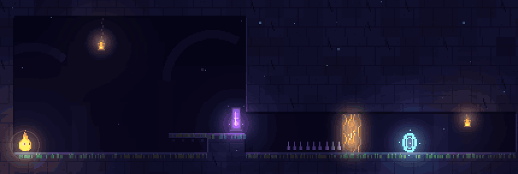

# ECHOES

A side-scrolling puzzle platformer built with LÖVE 11.5. You play a small lantern-spirit in a dark, glowing ruin. Press the echo key and a ghost of your last three seconds appears. Echoes are solid on top and press plates, so you can leave yourself behind to hold a door open or to climb on.



*Level 10, Ferry. Cast at the shrine and your reflection replays your last three seconds mirrored. It waits as long as you waited, so you can step onto it and ride it over the spikes.*

## Play

You need [LÖVE 11.5](https://love2d.org). On Windows the scripts expect it in `C:\Program Files\LOVE`. On other systems they call `love` from your PATH, or the binary named in `$LOVE`.

    scripts\play.cmd        (Windows)
    scripts/play.sh         (macOS, Linux)

Extra arguments pass through, so `scripts\play.cmd --shot title` runs a dev tool (see Dev tools).

LÖVE loads the `game/` folder, not the repo root. By hand, run `love game` from the repo root. On Windows, `lovec.exe` is the console build and prints stdout.

### Controls

| Action | Keyboard | Gamepad (Xbox-style, hot-plug is fine) |
| --- | --- | --- |
| Move | Left / Right, or A / D | D-pad or left stick |
| Jump | Z, Space, W or Up (hold for height, release to cut the jump) | A |
| Cast echo | X or K | X or B |
| Restart level | R | Back |
| Pause | Esc or P | Start |
| Menus | Arrows or W/S, Z/Space/Enter to confirm, Esc/Backspace to go back | D-pad or stick, A confirm, B back |

The pad rumbles lightly on death and on cast. On-screen prompts follow whichever device you used last.

### The echo mechanic

- The game records every simulation step. Casting copies the last 3 seconds (180 frames) into an echo.
- The echo appears where you were 3 seconds ago, replays your movement, then stays frozen at its final pose (where you cast it) for 4 seconds before fading.
- An echo is a one-way platform. You can land on it and ride it as it moves, and you can jump up through it from below.
- Echoes weigh down pressure plates. A door is open only while its plate (same letter) is pressed by you or an echo.
- At most 2 echoes exist. A third cast removes the oldest.

Standing on a plate for 3 seconds before you cast gives an echo that sits on the plate for about 7 seconds. Casting at the peak of a jump leaves a platform in mid-air.

Three tiles change what an echo does:

- Mirror shrine (violet). Cast while touching it and the echo replays reflected about the shrine, so it walks where you did not, through walls included. Mirrored echoes are violet.
- Veil (amber). You walk through it. An echo whose next step would enter it stops right there and stays for 4 seconds, so a veil is where you park a ghost.
- Crumble stone (ochre). Half a second after any body stands on it, you or an echo, it gives way. It grows back 3 seconds after nothing is left inside it. Echoes replay positions, so a ghost keeps standing where the stone used to be.

### Levels

Act one teaches the echo: 1 Wake (movement, gaps, spikes), 2 First Echo (a plate and a door), 3 Stairway (an echo of your jump as a step), 4 Two Minds (two plates, two doors, two echoes), 5 Ascent (a tall climb that combines everything).

Act two introduces one tile each: 6 Other Side (a plate in a sealed room, pressed by a reflected echo), 7 Trapdoor (a plate on crumble stone), 8 Undertow (a veil parks the ghost you climb), 9 Underfoot (the door is the floor).

Act three combines them: 10 Ferry, 11 Short Memory, 12 Confluence.

A level unlocks when the previous one is cleared. Progress (cleared levels, best time, fewest deaths) and settings (volumes, screen shake, fullscreen) are saved to `save.txt` in the LÖVE save directory (`%APPDATA%/LOVE/echoes` on Windows). A missing or corrupt file falls back to defaults.

## Test

    scripts\test.cmd        (Windows)
    scripts/test.sh         (macOS, Linux)

Runs `--selftest`, `--flow` and `--slack` in turn, stops at the first failure and exits nonzero.

## Dev blog

`devblog/` is a Hugo site with one post per milestone of the build. Preview it with `hugo server --source devblog` from the repo root. `devblog/README.md` covers building it and regenerating its screenshots.

## Folder map

```
README.md
scripts/            play and test launchers (.cmd for Windows, .sh elsewhere)
devblog/            the Hugo dev blog, separate from the game
game/               the LÖVE project root (love loads this folder)
  main.lua          fixed-step loop and the command-line modes (--selftest, --flow, --shot, ...)
  conf.lua          window and save identity; switches off graphics and audio for headless modes
  world/            the simulation. No love.* calls, so it runs headless.
    level.lua       map parsing, LEGEND and TILES, collision, plates and doors, the world step
    player.lua      player state machine (ground, air, dead, cleared)
    echo.lua        ring-buffer recorder and the echo that replays it
  content/
    levels.lua      the twelve ASCII level maps with names, hints and act breaks
  screens/          which screen is showing and how the player moves between them
    scenes.lua      title, play, pause, level select, settings, clear card, ending
    progress.lua    act layout and the cleared/unlocked state of each level
    menu.lua        the one menu model shared by every menu
    transition.lua  the iris wipe between scenes
  gfx/              everything drawn
    render.lua      world drawing, lighting, camera, procedural tile art
    particles.lua   motes, bursts and trails
    ui.lua          menu and text drawing
    hud.lua         in-level overlay
    hudmodel.lua    the numbers the HUD shows, kept apart from drawing
  platform/         talks to the machine
    input.lua       keyboard and gamepad to actions, with held-key and repeat handling
    save.lua        save file read, write and validation
    assets.lua      optional art and sound overrides (the SLOTS registry)
    sfx.lua         generated sounds, or your files from assets/sfx
  dev/              developer tools, loaded only by the flags below
    selftest.lua    headless checks (--selftest)
    uitest.lua      menu and HUD checks, run as part of the selftest
    flowtest.lua    scripted key presses through the real scenes (--flow)
    solutions.lua   a scripted solution and a human-style strategy for each level
    slack.lua       how forgiving each decision is (--slack)
    bench.lua       frame-time and allocation benchmark (--bench)
    shot.lua        deterministic screenshots (--shot)
    imgdiff.lua     pixel diff of two screenshots (--diff)
    record.lua      numbered frames of a scripted playthrough (--record)
  assets/           optional PNG and sound overrides, see game/assets/README.md
```

Modules require each other by dotted path from `game/`, for example `require 'world.level'`. Nothing in `world/` requires another folder, and `content/` is plain data. Keep it that way.

## How a frame flows

`main.lua` accumulates real time and runs fixed 1/60 s steps. Each step turns pending key and pad events into menu actions with `platform/input.lua`, hands them to `screens/scenes.lua`, then updates the active scene. A play scene reads the held input and calls `Level.step` in `world/level.lua`, which moves the player and the echoes and checks plates, doors, hazards and the goal. It leaves the frame's events in `world.events`, and the scene turns them into particles, sound and rumble. `love.draw` then calls the scene's draw. That has `gfx/render.lua` draw the world, `gfx/particles.lua` and `gfx/hud.lua` draw over it, and `gfx/ui.lua` draw menus on top. The simulation never draws and never reads the clock, so the headless tests and the scripted solutions replay it exactly.

## Changing the game

**Add a level.** Append a table to `game/content/levels.lua` with `name`, `hint` and a `map` of equal-width strings. Set `act` on the first level of a new act. The legend is at the top of that file. Add a scripted solution in `game/dev/solutions.lua` so `--selftest` can prove the level is solvable.

**Add a tile.** Pick a character and add it to `LEGEND` in `game/world/level.lua`. Add a `TILES` entry in the same file with its behavior flags (`solid`, `hurts`, `light`, `worldList` and so on). Give it a draw function in `game/gfx/render.lua` next to the existing `procedural*` ones, wrapped in `withSlot` so artists can replace it, and add a matching slot in `game/platform/assets.lua`.

**Add art or sound.** Drop a PNG in `game/assets/sprites` or a sound in `game/assets/sfx`, named after a slot. The slots, sizes and animation convention are in `game/assets/README.md` and defined in the `SLOTS` table of `game/platform/assets.lua`. A slot without a file keeps the procedural version.

## Dev tools

Pass these to `scripts/play` or run `love game <flag>` from the repo root.

| Flag | What it does |
| --- | --- |
| `--selftest` | Runs the simulation headless and prints PASS or FAIL per check. Covers physics, hazards, plates, echoes, the three special tiles, a scripted solution for every level, and reruns with timings shifted by three frames. Levels 6 to 12 must also fail when played naively. Exits nonzero on failure. |
| `--flow` | Drives the real scenes (title, pause, settings, clear card, level select) with key events against an in-memory save. |
| `--slack [N] [name=value ...]` | Measures how forgiving a level is. Sweeps each human decision in the level's strategy (how long to wait, where to turn back) and prints the width of the winning window. `N` picks one level and `turnX=120` moves a nominal value. Every decision needs at least 30 frames or 24 px of slack to pass. |
| `--bench LABEL [--size WxH] [--profile]` | Plays the title, menus and every level's solution with vsync off. Prints median, p95, p99 and max frame time, draw calls and allocation per scene, and writes CSVs under `bench/` in the save directory. `--profile` adds a per-function breakdown. |
| `--shot TARGET [F]` | Saves a PNG to the save directory and prints its path. TARGET is a level number (0 is the title), `title`, `pause [N]`, `select [cleared]`, `settings`, `clear [N]` or `transition`. For a level, F plays its scripted solution for F frames. Shots are deterministic. |
| `--record N` | Plays level N's scripted solution and saves every second frame (30 fps) to `record/` in the save directory, stopping just after the clear card appears. The README GIF came from `--record 10`. Crop the frames, build a palette, then encode in a separate pass (a one-pass `split`/`palettegen` graph silently drops all but the last frames): `ffmpeg -i record/f%05d.png -vf crop=860:290:40:190 c/c%05d.png`, then `ffmpeg -i c/c%05d.png -vf palettegen=max_colors=96 -update 1 pal.png`, then `ffmpeg -framerate 30 -i c/c%05d.png -i pal.png -filter_complex "[0:v][1:v]paletteuse=dither=none" ferry.gif`. Check the frame count of the result. |
| `--diff A.png B.png` | Compares two PNGs in the save directory pixel by pixel, writes `B_diff.png` with differing pixels in red, and prints how many differ. |

To check that a change left the visuals alone, take a shot before and after, then diff them: `love game --shot 10 330`, then `love game --diff before.png shot_10_f330.png`.
